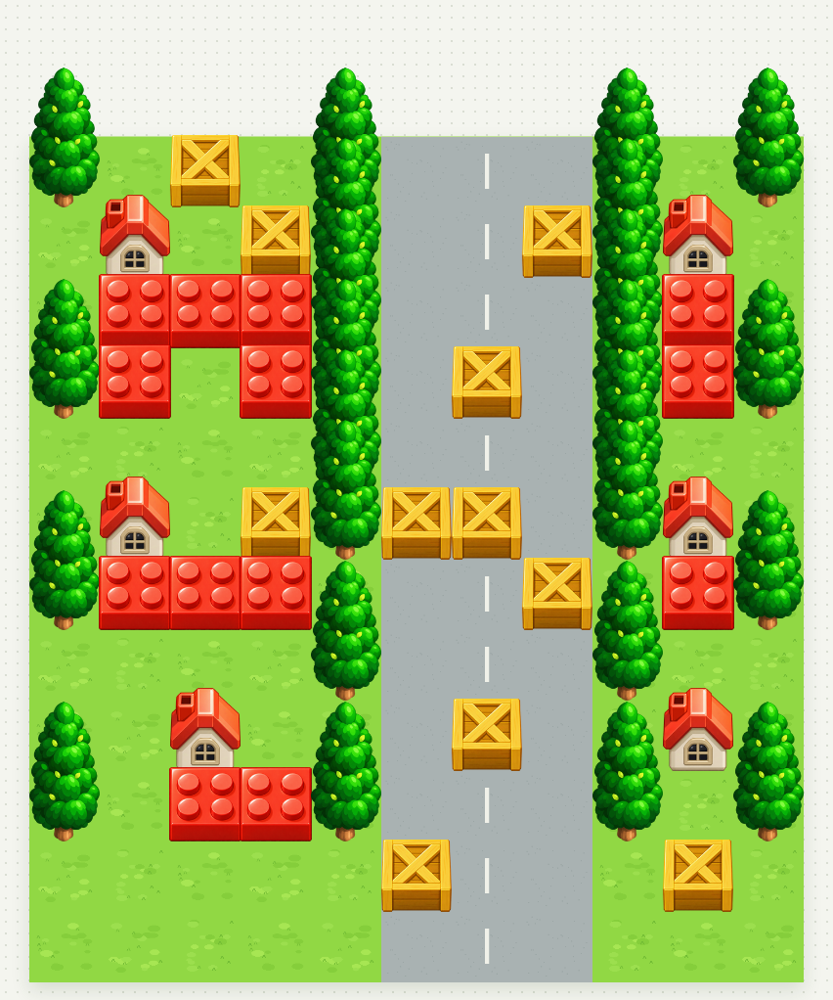
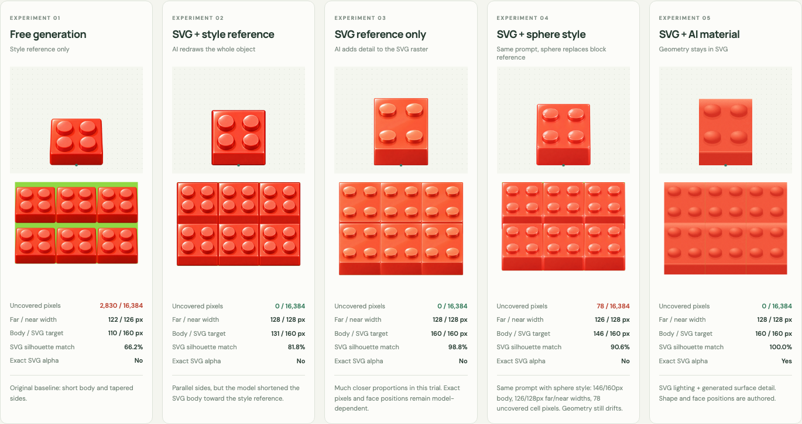
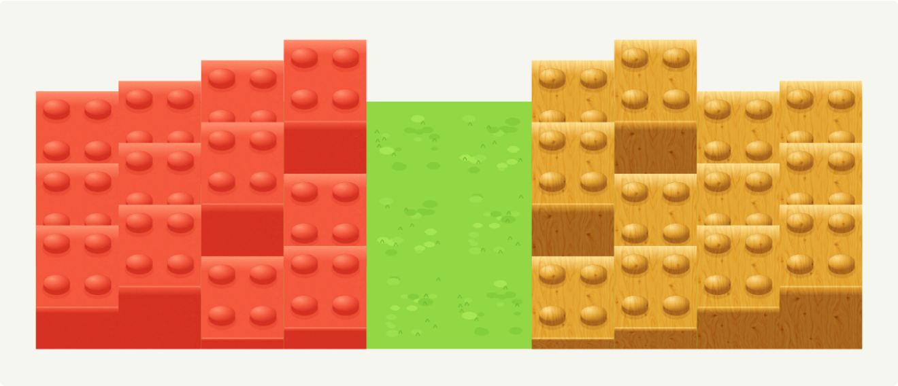

# Tile Foundry

A reproducible image-generation → tile-processing → React-preview workflow for
square-grid, orthographic top-and-front game art. Full sprites have different heights and
overlap rows behind them; their logical cells stay the same size.

[Open the playground](https://tile-foundry-yiochen.netlify.app/) ·
[Play the dance animation](https://tile-foundry-yiochen.netlify.app/?view=animations)



## Start

Requires Python 3.10+ and Node.js 20.19+ or 22.12+.

```sh
python -m pip install -r requirements.txt
npm ci
npm run assets
npm run dev
```

Open the address printed by Vite. For remote/mobile use, forward that port through
your normal remote-development setup. The playground adapts to a phone screen.
The generated assets and assembled demo are checked in, so no image API key is
required to run or rebuild the demo.

## What's here

| Path | Purpose |
| --- | --- |
| `tools/tilekit.py` | CLI for guides, alpha cleanup/crops, grid/component splitting, normalization, atlas packing, validation, Tiled export |
| `tools/build_demo.py` | Rebuild all derived demo assets from the original generated PNGs |
| `tools/svgkit.py` | Parameterized SVG geometry, raster references, face masks, and generated-material compositing |
| `tools/build_experiments.py` | Reproduce the workflow comparison and eight material/height variants from saved sources |
| `tools/character_guides.py` / `tools/build_character_experiments.py` | Seven character guide, ground-anchor, and floor-removal trials |
| `tools/calibration_guides.py` | Sparse square-floor and six-pose SVG guides, with portable panel layouts |
| `tools/eval_tile_skill.py` / `tools/run_skill_evals.py` | Behavioral eval artifact grader and saved-run replay |
| `src/` | React scene editor and cuts/atlas preview |
| `assets/source/` | Original AI-generated transparent images, untouched |
| `assets/references/5610.jpg` | Original user-supplied game-art reference, saved unchanged with a SHA-256 sidecar |
| `assets/source-config.json` | Reviewed cleanup, art-width, and optional source-anchor settings |
| `assets/prompts/generation.json` | Actual prompts used for the initial four assets |
| `skills/build-overlap-tiles/` | Agent skill with reusable prompts and acceptance checks |
| `public/assets/village.tmj` | Editable Tiled village map with image-collection object tiles |
| `public/assets/stress.tmj` | Dense overlap test map |
| `public/assets/contact.tmj` | Fully packed solid blocks to expose gaps and taper |
| `docs/` | Browser screenshots and workflow findings |

## Useful commands

```sh
# Geometry guides for low, medium, and tall art
python tools/tilekit.py guides assets/guides

# Remove observed weak-alpha haze, then crop the complete silhouette
python tools/tilekit.py clean-alpha assets/source/tree.png tmp/tree-clean.png --min-alpha 64
python tools/tilekit.py crop-alpha tmp/tree-clean.png tmp/tree-crop.png --padding 4

# Split a regular sheet; never use cell-sized cuts on a flattened overlapping scene
python tools/tilekit.py split-grid public/assets/sheet.png tmp/grid-cuts --cell 192 320 --columns 2 --rows 2 --spacing 24

# Find separate silhouettes on a transparent sheet
python tools/tilekit.py split-components public/assets/sheet.png tmp/component-cuts --min-area 100

# Uniform scale, full tall frame, fixed ground anchor
python tools/tilekit.py normalize tmp/tree-clean.png tmp/tree-normal.png --frame 192 320 --anchor-out 96 312 --art-width 128

# Atlas trimming updates each ground anchor; gutters extrude edge pixels
python tools/tilekit.py pack public/assets/tiles.json tmp/atlas.png --padding 4 --extrusion 2
python tools/tilekit.py validate public/assets/tiles.json

# Catch gaps and perspective taper on a joinable solid-cell sprite
python tools/tilekit.py check-solid public/assets/sprites/block.png tmp/block-check.json --anchor 96 312 --preview

# Export a saved playground scene to editable Tiled format
python tools/tilekit.py export-tiled public/assets/village.json public/assets/tiles.json public/assets/village.tmj
```

Every image-processing command retains useful JSON metadata. Use `--help` on a
subcommand for input options. Output paths are explicit; originals are not replaced.

## Playground

- Scene / Sprite cuts / Atlas views; village, dense overlap, and solid-contact presets.
- Grid, ground anchors, and authored collision overlays.
- Compare trimmed-atlas rendering with individual PNG rendering.
- Inspect, place, and erase by logical cell; undo up to 30 edits.
- Import/export scene JSON and export the actual preview PNG.
- Separate logical footprint, visible-art bounds, and drawing anchor in the inspector.
- Workflows: five trials side by side, block versus sphere style references, measured joins, SVG outline, live material/height controls, and a mixed-height scene.
- Characters: box, stick, SVG, raster, and jumping guides; floor-derived normalization, five green-key cutouts, two detached extractions, and exact-subtraction comparisons.
- Animations: playable six-frame dance trials, frame stepping, playback speed, light/dark backgrounds, fixed ground anchors, spritesheet downloads, and the lava tile repeated in a 3 × 3 grid. Open `?view=animations` directly.

## Netlify publishing

`netlify.toml` builds the committed playground with `npm run build`, publishes
`dist/`, and selects Node.js 22. The processed assets are committed, so cloud
builds need no Python installation or image-generation credentials. When changing
saved sources, run `npm run assets` locally and commit the derived assets too.

The Git-connected Netlify project publishes pushes to `main` automatically and
builds Deploy Previews for pull requests. Local Netlify link state is ignored via
`.netlify/`.

Project: [tile-foundry-yiochen](https://app.netlify.com/projects/tile-foundry-yiochen).
Production: [tile-foundry-yiochen.netlify.app](https://tile-foundry-yiochen.netlify.app/).

## Character anchors: tested results

The floor sets position and scale independently of the feet. A visible shoe bottom
can extend below the cell center without moving the ground anchor. Simple stick
guides leave more room for character design than detailed artwork. Solid floors
were repainted, so exact-reference subtraction failed; an explicitly configured
green chroma key removed the floor from all five saved solid-floor outputs.
Mixed shoe edges are approximate, and the key hue must be reserved in the floor
region. Two detached-corner trials also produced cutouts. These are seven single
generation trials, not a reliability or creativity benchmark.

Character frames stay 192×320 on the same 128px logical grid. Their anchor is
the floor **center (96,248)**. See [the complete character experiments](docs/character-anchor-experiments.md)
for exact inputs/prompts, measurements, processing commands, clean sprites, and Tiled export.

## SVG first: tested results



The target was a 128×128 top face and a 32px front wall. All AI outputs were
cleaned and scaled uniformly; none were stretched into the SVG shape.

| Workflow | Opaque body height / target | Missing pixels in repeated 128×128 cell | SVG silhouette IoU |
| --- | --- | --- | --- |
| Initial free generation | 110 / 160px | 2,830 | 66.2% |
| SVG + polished style reference | 131 / 160px | 0 | 81.8% |
| SVG reference only | 160 / 160px | 0 | 98.8% |
| SVG + sphere style reference | 146 / 160px | 78 | 90.6% |
| SVG geometry + AI material | 160 / 160px | 0 | 100%, exact SVG alpha |

**SVG first works well as guidance. Keep SVG geometry and composite generated
materials when exact repeatable geometry is required.** The sole-SVG render had
richer illustration but remains a model redraw. The material path trades some
illustration freedom for authored silhouettes, faces, studs, lighting, and heights.
These are individual trials, not a statistical model benchmark. No alpha gaps
does not imply continuous grain, identical color at joins, or connected terrain.

The sphere follow-up keeps the SVG + block-style prompt unchanged and substitutes
a generated glossy plastic sphere for the second image. It improves body height
over that earlier trial, but still shortens the body and widens the near side
(126px far / 128px near). See [sphere experiment inputs, method, and limitations](docs/sphere-reference-experiment.md).

```sh
python tools/svgkit.py template tmp/my-block --height 64 --palette amber
python tools/svgkit.py material tmp/my-block assets/source/wood-material.png tmp/my-wood-block.png --strength .7
python tools/build_experiments.py
```

The same two generated material images produce four heights each without new AI
calls. The **Workflows** view previews them at a fixed 128px ground pitch.



Recipes and expanded generation prompts are in the repo skill and `assets/prompts/`.
See [detailed findings](docs/workflow-findings.md) and the machine-readable
[`workflow-comparison.json`](docs/workflow-comparison.json).

## Add another asset

Generate a complete isolated PNG using the repo skill. Keep the source and its
actual prompt. Add its source configuration and demo registration in
`tools/build_demo.py`, then rebuild. For a standalone PNG, use the generic CLI
without changing the demo. If the visible silhouette's bottom is not its ground
contact, explicitly supply source anchor coordinates; never guess from image size.

To use the skill with a coding agent, point it at
`skills/build-overlap-tiles/SKILL.md`; copy that folder into your agent's skill
directory if its discovery system requires installation. The skill is packaged
in this repo and does not change your account-level skills automatically.

## Skill workflow and evals

The repo skill now covers visible floors (for example, **generate a lava tile**)
and objects/animations on removable calibration floors (for example,
**generate a player dancing spritesheet on tile**). Its default uses sparse SVG
guidance, textual appearance, and the intact floor to set scale and anchor before
explicit green keying. See [the runnable workflow](skills/build-overlap-tiles/references/floor-and-objects.md).

Fresh independent executions produced a lava floor and two dance attempts.
The first dance failed pose diversity. The corrected retry passed after an
explicit transparent-separator recovery preserved fingers protruding into the
planned gutter. Both attempts, strict-cut refusal, exact prompts, original PNGs,
and independent reviews are retained; no failed generation was hidden.
See [eval findings and previews](docs/skill-eval-findings.md) and
[the fresh-run protocol](skills/build-overlap-tiles/evals/protocol.md).

```sh
# Replay all saved artifact checks, including the expected failed first attempt
npm run eval:skill
```

Replay checks sources, geometry, alpha, measured floor normalization, sheet
reconstruction, and the saved visual reviews. It does not run image generation
or measure how today's agent follows the skill; a new behavioral score requires
a fresh execution of the two short prompts.

## Verify

```sh
python -m unittest discover -s tests
npm run assets
npm run build
npx playwright install chromium
npm run verify
```

The browser check starts a temporary local Vite server, tests desktop/mobile,
cell editing and undo, scene import/export, all preview modes, renderer parity,
and captures real screenshots in `docs/`. Set `CHROMIUM_EXECUTABLE` to use an
existing Chromium binary. No external page or login is used for this check.

The current demo covers independent one-cell objects. Connected raised terrain,
complex bridges, and multi-cell depth interactions need authored adjacency/depth
rules. See [workflow findings](docs/workflow-findings.md).

The original supplied game-art reference is retained unchanged in
`assets/references/5610.jpg`. Sample objects, the sphere style reference, and flat
material swatches were generated with the built-in image-generation tool; source
files and exact prompts are retained. Floor tiles are deterministic procedural
assets with a shared boundary band. The code is MIT-licensed.
