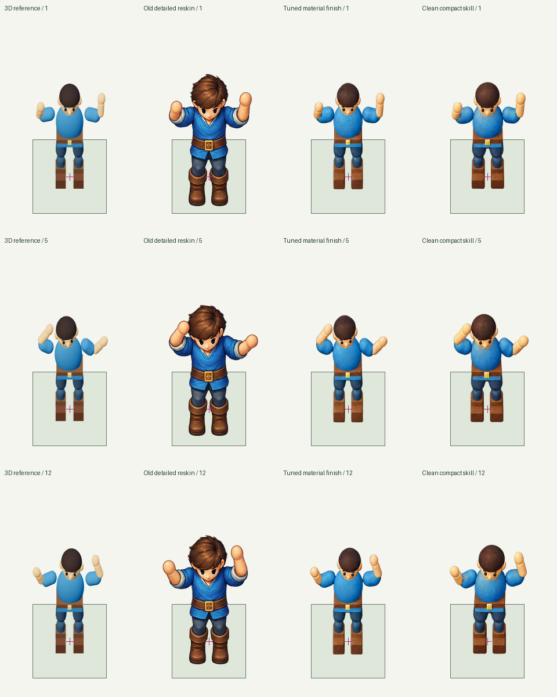

# Full-suite 3D controls and scale-preserving reskin prompts

Fresh direct 3D controls pass **11 of 14 cases**. The three animated terrain cases
fail on visible spatial material seams; their geometry, delivery and timing pass.
A directly tuned material-finish prompt passes both character cases. A fresh
executor applying the compact skill passes the dance, while its eight-direction
sheet still fails standing-height consistency across rows.

## Full control run

All 14 cases were freshly modeled/rendered with Three.js; no image-generation
calls or old raster inputs were used. These are authored controls, not blind
executions of the skill. Model/material/shader, camera, rig/pose and source
captures are retained in each case. The original case definitions, grader and
independent LLM visual policy are unchanged.

| Case | Independent result |
| --- | --- |
| seamless-square-floor | Pass |
| lava-tile | Pass |
| full-cell-raised-object | Pass |
| partial-cell-tall-object | Pass |
| floating-object | Pass |
| character-directions | Pass |
| large-object-2x2 | Pass |
| large-object-3x2 | Pass |
| disjoint-support-arch | Pass |
| animated-waves | Fail: animated material boundary bands |
| animated-lava | Fail: animated material boundary bands |
| seated-character-separated | Pass |
| dancing-player | Pass |
| authored-flowing-lava | Fail: animated material boundary bands |

The terrain shader's stationary boundary transition becomes a visible band in
moving phases and offset-phase neighbors. Phase-zero examples look cleaner.
This is an authored material/shader defect: controlled projection alone does not
make textures seamless. All phases and actual 12 fps playback were inspected.
The original supersampled wave development capture is preserved under
`development/animated-waves-supersampled`; native integer capture removed alpha
softening, but did not resolve the independently observed material bands.

The arch uses separately rendered 3D depth groups and passage comparisons.
The seated case retains complete stool and character renders plus the shared
scene and alpha recomposition. Neither was sliced out of a flattened scene.

## Prompt tuning and clean forward tests

Each row below represents two new built-in image calls, one per character case.
The original generated PNGs, exact expanded prompts/tool arguments, references,
failed extractions and independent reviews are preserved. Fresh 3D captures in
the clean runs reproduce the exact same reference raster hashes, holding the
input image constant across all four prompt variants. There are eight distinct
new AI outputs in total, without retries inside an attempt.

| Run | Approach | Directions | Dance |
| --- | --- | --- | --- |
| `3d-reskin-r3` | Surface repaint, with new hair/facial detail | Fail: north becomes front-facing | Pass |
| `3d-reskin-r4` | Direct compact material/lighting finish | **Pass** | **Pass** |
| `3d-reskin-r5` | Clean executor, expanded skill prompt | Fail: height/contact/placement | Fail: boundary/clipping rejection |
| `3d-reskin-r6` | Clean executor, compact skill prompt | Fail: row-to-row standing-height drift | **Pass** |

Run IDs have prefix `2026-10-17-`. Each clean executor received only the frozen
skill, realistic requests and runtime access, without previous prompts, grades
or expected rubrics. Separate reviewers inspected original sources and every
available sprite at native/2× on light/dark, authored neutral/floor references,
and real candidate animation including the 12→1 boundary. The failed dance has
no delivered frames; its control animation was not substituted as candidate
motion evidence. The final direction failure is a qualitative observation of
roughly five native pixels of crown variation, not a strict pixel-diff gate.



The comparison uses complete frames 1, 5 and 12, with no silhouette fitting,
clipping, scale compensation or adjusted foot roots. It was created separately
from independent review packets and was not an answer key for reviewers.

## Best practice recorded in the skill

- Request a **material-and-lighting finish on existing geometry**. Retain the
  original forms while changing painted color, shading and texture.
- Name a few easily reinterpreted shapes: the hair contour, shoe profile, body
  proportions and whether the face is visible. A request for facial detail in
  every panel can incorrectly turn a rear view forward.
- Keep the image prompt compact. Leave world units, runtime anchors, capture-scale
  conversions and export commands in the manifest; the rendered input already
  carries that geometry. The final executor independently wrote 160/167-word
  prompts from the skill. This small unpaired sample does not establish prompt
  length as the cause of success or failure.
- Author the desired character design in 3D first. Surface-only edits preserve
  more of the source's simple forms and offer less redesign freedom than a
  polished character redraw.
- Retain one authored camera, root and sheet layout; use only the declared
  whole-canvas uniform sampling. No renderer masks, per-pose resizing, foot
  fitting, alpha-box normalization or post-hoc panel recovery were used.
- Validate every direction and row, plus motion and the last-to-first boundary.
  The accepted direct prompt and the passing clean dance do not establish
  reliable eight-view consistency or pixel-perfect AI output.

The portable workflow and prompt template are in
[the skill](../skills/build-overlap-tiles/SKILL.md) and
[3D reference](../skills/build-overlap-tiles/references/three-dimensional.md).
The directly accepted expanded prompts are under
[`3d-reskin-r4`](../assets/evals/2026-10-17-3d-reskin-r4/).
All 14 controls are under
[`3d-control-all`](../assets/evals/2026-10-17-3d-control-all/).
The [original pre-generation plan](../assets/evals/2026-10-17-3d-control-all/experiment-plan-before-generation.md)
and [snapshot/source integrity audit](3d-control-prompt-tuning-integrity.json)
are retained.

## Provenance and verification

The frozen suites and skill files remain hash-verified. A depth-piece review
preview helper was fixed to use the case grid when a piece has no separate
logical footprint; it changes no art, guide, result metadata or grading policy.
The expanded clean run also needed a serialization-only submission path repair:
`render/guide.json` resolves the same guide bytes beside their authored reference
images. Its original submission and repair record remain intact.

The playground exposes the latest result, exact prompt, source and review for
every case. Assessment labels distinguish the all-case 3D control, direct prompt
variants and clean skill tests. Renderer JSON/JS inputs are downloadable files,
not broken image previews. All earlier attempts remain selectable.

```sh
.venv/bin/python tools/run_skill_evals.py --run assets/evals/2026-10-17-3d-control-all
.venv/bin/python tools/run_skill_evals.py --run assets/evals/2026-10-17-3d-reskin-r3
.venv/bin/python tools/run_skill_evals.py --run assets/evals/2026-10-17-3d-reskin-r4
.venv/bin/python tools/run_skill_evals.py --run assets/evals/2026-10-17-3d-reskin-r5
.venv/bin/python tools/run_skill_evals.py --run assets/evals/2026-10-17-3d-reskin-r6
```

Replay reproduces both passes and failures; it does not rerun image generation.
Shared validation: 136 unit tests, asset generation, production build, and
playground desktop/mobile checks including 12 fps playback, scrubbing, overlays,
control selection and renderer input links.
