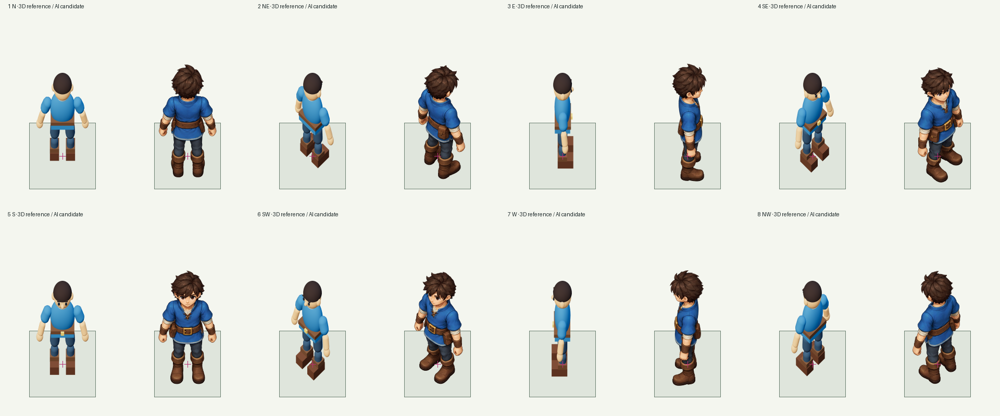

# Subject-aware 3D → imagegen reskin, all 14 cases

The workflow uses 3D for the camera, placement, size, pose and support, then
imagegen for finished art in every case. Characters and difficult organic forms
can replace crude shapes with refined anatomy, hair, hands, boots and clothing.
Simple blocks and structures retain useful modeled form and improve materials,
bevel shading and detail. Fixed registration does not imply an AI result kept it.

This run freezes the existing 14-case suite and the revised portable skill before
fresh generation. Three clean executors receive requests and the frozen skill,
without old prompts, grades or rubric answer keys. Existing complete 3D captures
are reused as declared geometry inputs. They are not claimed as fresh renders or
AI candidates. Each final source is a new built-in imagegen output.

There are 16 planned calls: one for each ordinary whole asset/sheet, two for the
separate stool and character, and two for the complete arch depth pieces. The
whole arch is composited from those independent AI pieces at authored transforms;
no flattened scene is sliced. Sources, prompts, exact tool arguments, reference
hashes, extraction guides and processing diagnostics are retained with each case.
No per-subject scale/anchor fitting, silhouette mask or clipping is allowed.
All animation is twelve frames at 12 fps.

The frozen fresh run is `assets/evals/2026-10-17-3d-creative-reskin-all`.
The [coverage audit](../assets/evals/2026-10-17-3d-creative-reskin-all/reskin-coverage-audit.json)
confirms all 14 cases have new AI sources (16 outputs total), with reference hashes
and source-to-result provenance. No untouched render is substituted for a failed
AI delivery. [Snapshot and suite integrity](3d-creative-reskin-integrity.json)
records the unchanged rubric and preserved skill snapshots.

## Independent review

The original frozen run passes **5/14**. The visual criteria and LLM review policy
are unchanged; image differences do not gate visual grades.

| Case | Original fresh attempt |
| --- | --- |
| Seamless square floor | Pass |
| Lava tile | Delivery fail: canvas-rounding check |
| Full-cell stone plinth | Pass |
| Partial-cell lantern | Pass |
| Floating orb | Pass |
| Character directions | Fail: enlarged nominal design and shifted support |
| 2×2 fountain | Fail: changed projection/footprint |
| 3×2 greenhouse | Pass |
| Disjoint-support arch | Fail: changed projection/support placement; depth occlusion works |
| Animated waves | Delivery fail: art crosses authored panel boundaries |
| Animated lava | Delivery fail: art crosses authored panel boundaries |
| Seated separate layers | Delivery fail: character canvas-rounding check |
| Dancing player | Fail: body scale, contact stability and loop placement |
| Authored flowing lava | Fail: phase-dependent geometry/root drift and disconnected neighbors |

The character redesign is visibly stronger than the earlier material-only pass.
Hair, face, hands, tailored clothing and natural boots replace crude primitives.
That creative success does not establish scale fidelity. At identical stored
roots, the new heels/boots and body extend beyond the supplied nominal design;
the dance also changes support placement between sheet rows. Back views expose
heel displacement independently of the legitimate length of forward shoe toes.



The terrain reskin adds rich material detail, but the flowing-lava sheet visibly
moves later rows upward. Phase-offset repetitions show large gaps and steps.
Actual candidate playback visited all 12 frames and wrapped twice at 12 fps without
browser errors. That verifies the player, not seamless motion or correct geometry.
Two other terrain sheets remain source-only and have explicitly labeled raw
players; no normalized registration or successful separation is claimed for them.

## Separate processing correction

The old processor tested X/Y aspect ratios before computing its common scalar.
For a 384×640 reference and 971×1620 source, this extrapolates a 1.667px discrepancy
and rejects the image even though a single least-squares scalar leaves actual
canvas residuals below one source pixel in both dimensions. The maintained helper
now checks those actual residuals. It still uses one scalar, zero fitting/offset,
strict gutters, complete borders and transparent virtual padding of at most 1px.
Regression tests cover this case and excessive/asymmetric aspect drift.

The [separate processing comparison](../assets/evals/2026-10-17-3d-creative-rounding-comparison/REPROCESS.md)
retains the same three lava/stool/character source PNGs and exact recipes, then
reprocesses them with the corrected frozen helper. It makes **zero new AI calls**.
The original failures, snapshots and grades remain selectable. Re-extraction
succeeds. Lava still fails on visible neighboring joins. The separated seated
layers pass delivery, isolation, complete-layer and seat-contact checks; their
obscured projected ground root remains uncertain, so that case is labeled
**needs visual review**, rather than passed. The latest view therefore has five
passes, eight failures and one case awaiting visual confirmation.

## Workflow guidance

- Choose shape permissions per subject: refine difficult anatomy/organic forms;
  preserve the useful base, wall and outer form of simple rigid structures.
- Name functional invariants separately from contours: root, nominal body scale,
  pose/facing, support elevation, attachment and complete frame layout.
- Keep independent layers/depth pieces complete through capture, reskin and
  recomposition. A source-only attractive picture cannot establish separation.
- Keep the full source and fixed extraction. Do not compensate for enlargement
  with fitted anchors, per-frame shrinking, renderer stencils or clipped details.
- Evaluate creative change and registration separately. A material-only copy can
  preserve crude shapes; a polished redesign can still miss the requested scale.
- Inspect every phase at stored roots and in repeated/offset neighbors, including
  the last-to-first transition. A successful 3D capture does not certify its reskin.

All latest attempts, exact prompts, supplied references, originals, runtime/raw
players and independent reviews are available in the
[playground](https://tile-foundry-yiochen.netlify.app/?view=evals).

```sh
python tools/audit_reskin_run.py assets/evals/2026-10-17-3d-creative-reskin-all
python tools/run_skill_evals.py --run assets/evals/2026-10-17-3d-creative-reskin-all
python tools/run_skill_evals.py --run assets/evals/2026-10-17-3d-creative-rounding-comparison
```

The replay commands reproduce recorded passes **and failures**; they do not rerun
imagegen or turn a failed visual grade into a successful result.
