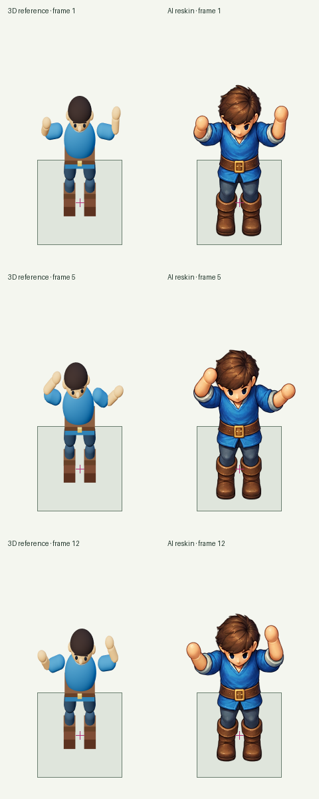

# Rigged 3D capture and image reskin experiment

## Plan recorded before image generation

Hypothesis: a skinned, posed 3D reference supplies more consistent geometry than
sparse SVG guides. Its source render has known projection/root/scale; an AI
reskin may preserve those better, but may also redraw or reflow them.

Use the unchanged `character-directions` and `dancing-player` cases from the
portable suite. Do not change prompts, expectations, visual policy or rubrics.
The former requests eight upright views; the latter requests twelve dance frames
at 12 fps. All runtime frames are 192×320 with a 128px cell and root (96,248).

Two clean executors receive their realistic request and the frozen skill, with
Node/Python/image-generation runtime access. They do not receive prior results,
failure diagnoses or the expected rubric. Each makes one built-in image call.
The new skill route uses a procedural, material-colored, skinned Three.js rig;
no external asset or downloaded animation is needed for this prototype.

Preserve direct 3D captures as a separately labeled control run with zero image
calls. Extract those original sheets with alpha threshold zero. Extract AI
reskins using the authored fixed panels and the predeclared global alpha cleanup
threshold 32/255. No detected panel recovery, masks, foot fitting, per-pose scales,
canvas cropping or threshold changes after seeing a source are allowed. A failed
extraction remains a failed delivery with the original PNG available.

Runs:

- `assets/evals/2026-10-17-3d-control`: unchanged direct 3D reference controls.
- `assets/evals/2026-10-17-3d-reskin-r1`: one fresh AI reskin per case.

Keep the scene, skeleton/weights, materials, bind pose, joint poses, camera and
projection matrices, floor/alpha/depth passes, color sheets, exact image prompts,
tool inputs, references, generated originals and source hashes. Render animation
at k/12 without a duplicated endpoint. The helper's affine capture matches
`screen=(96+128x, 248+128z-128y)`; no frame is fit to its visible bounds.

Use independent LLM visual review at native and 2× on light/dark backgrounds,
including all frames and live playback/12-to-1 inspection. Judge the reskin and
control separately against the same frozen criteria. Compare with the preserved
previous direction/dance assessments, without exposing those verdicts to new
reviewers. Pixel/landmark measurements are diagnostic; known frame metadata does
not establish visually correct anatomy or contact. These are small prototype
samples, not an estimate of model success rate.

## Forward iteration recorded before the third image call

Round 1's dance source triggered an extractor bug: its uniformly mapped outer
panel exceeded the source by a fractional pixel despite satisfying the documented
whole-canvas rounding tolerance. A new frozen processing-only run permits at most
one pixel of declared transparent virtual padding, while still rejecting art at
the original canvas boundary. Two synthetic regressions cover both cases. It
reuses the unchanged image with zero generation calls and still fails because
opaque AI art crosses an authored gutter (maximum alpha 250). No art was clipped
or panel registration recovered.

For `2026-10-17-3d-reskin-r2`, author a different dance before generation: only
periodic elbow curves change, leaving about 28px side clearance instead of about
13px. Camera, model scale, neutral pose, root, feet and all lower-body pixels stay
unchanged. Direction renders are unchanged. One new clean executor gets the same
dance request and the revised frozen skill, with one fresh image call. Existing
round-1 sources, failed extraction and processing-only attempt remain intact.
This tests a practical headroom revision; the unpaired generation cannot isolate
the causal effect of elbow angles alone.

## Results

| Route | Eight directions | Twelve-frame dance |
| --- | --- | --- |
| Previous SVG-based AI results | Failed | Failed |
| Untouched 3D capture control | **Passed** | **Passed** |
| 3D capture, then AI reskin | **Failed** | **Failed** (round 2 delivered all frames) |

Both direct 3D controls pass every deterministic delivery check and independent
visual criterion. They preserve the shared root, standing design height, camera,
complete alpha, all directions and a cyclic 12 fps dance. This is a simple
procedural 18-bone reference character, not a production art-quality benchmark.
Only these two character cases were rerun; the other suite cases are unchanged.

The eight-view reskin delivers all eight isolated frames with clean cutouts,
consistent identity and correct facing directions. The reviewer rejects the
standing-height target and contact/anchor placement: the first row sits lower
than the authored reference, while the second row shifts upward. Fixed metadata
does not repair the painted anatomy's position.

The second dance reskin delivers all twelve frames and passes delivery integrity,
projection, identity, complete limbs, readable poses, clean alpha and source
faithfulness. It fails anchor placement, design height, contact stability and
the loop: the reviewer observes whole-body shifts at row boundaries and a
12-to-1 downward pop. All frames and actual playback were inspected at native/2×
on light/dark backgrounds; these are qualitative findings, not exact landmark
measurements or a continuous-motion timing benchmark.



This diagnostic shows complete frames 1, 5 and 12 at native size, on the same
ground square/cross, with no silhouette or foot fitting. It was assembled after
independent review and did not provide that review's expected answer.

The controls therefore beat the prior SVG-based character results on these
criteria, but the full post-capture AI-reskin route does **not** achieve a full
case pass. Better reskin cutouts and usable delivery do not establish preserved
geometry. The updated skill distinguishes controlled 3D capture from optional
AI reskinning. For strict final registration, keep geometry in the renderer and
apply the art style to materials/UV textures before capture. That appearance
route is a recommendation, not an additional experiment performed here.

Three fresh built-in image calls were made in total: two in round 1 and one in
round 2. Controls and the processing comparison use zero additional image calls.
All attempts, sources, expanded prompts, supplied references, editable scenes,
rigs, poses, camera matrices, auxiliary captures, manifests and reviews remain
under the recorded runs. No old grade or source was removed. Control recipes
explicitly describe deterministic capture/extraction; their raster input is the
authored sheet passed to the extractor, not a claimed AI-model request.

The round-1 dance submission also needed a serialization-only guide path repair:
the exact same guide bytes are referenced at `render/guide.json`, where their
relative authored-render paths resolve. The original submission remains as
`submission-authored.json`. No art, guide geometry, prompt or processing changed.
The processing comparison independently resolved that same authored guide from
the provided capture bundle, and retained the original input record unchanged.

Reports are in each run's `reports/`; independent reviews of delivered outputs
are in `reviews/`. The playground lists direct controls as **3D render control (no AI
reskin)** in the Assessment selector and preserves the failed AI attempts.

```sh
python tools/run_skill_evals.py --run assets/evals/2026-10-17-3d-control
python tools/run_skill_evals.py --run assets/evals/2026-10-17-3d-reskin-r1
python tools/run_skill_evals.py --run assets/evals/2026-10-17-3d-reskin-processing
python tools/run_skill_evals.py --run assets/evals/2026-10-17-3d-reskin-r2
```

Replay success reproduces the recorded passes and failures; it does not turn all
cases into passes. Repository verification includes 134 passing unit tests,
actual WebGL/portable capture tests, asset generation, production build and
desktop/mobile playground checks. The existing 14 case definitions and grading
policy remain unchanged.
