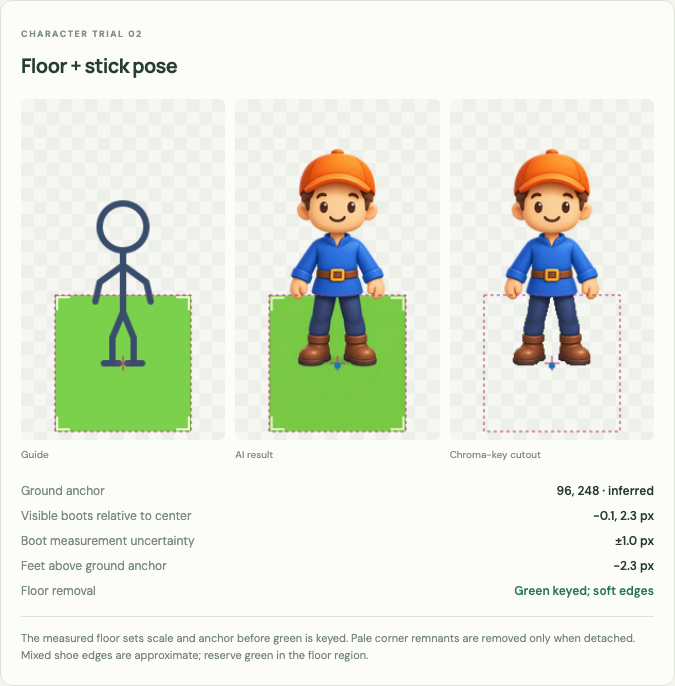
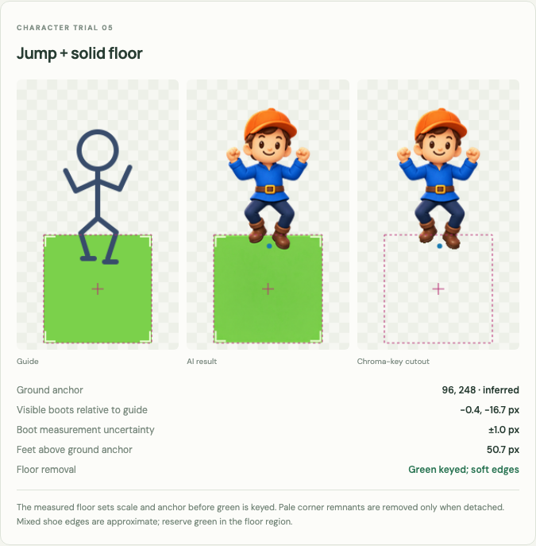
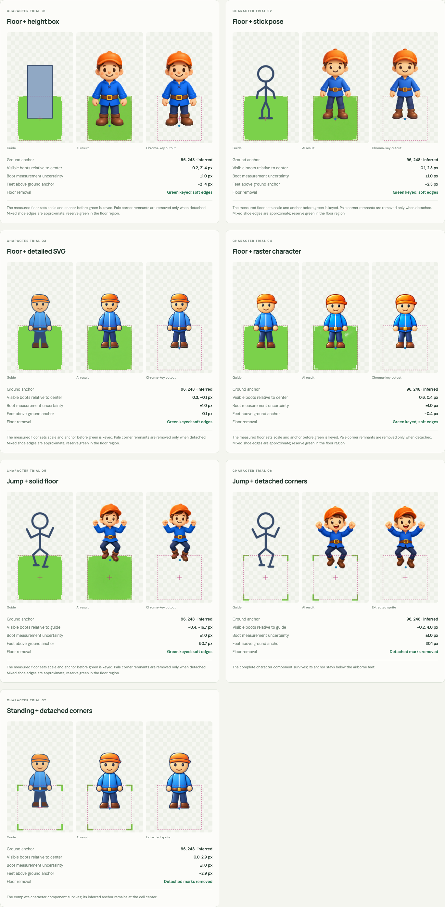
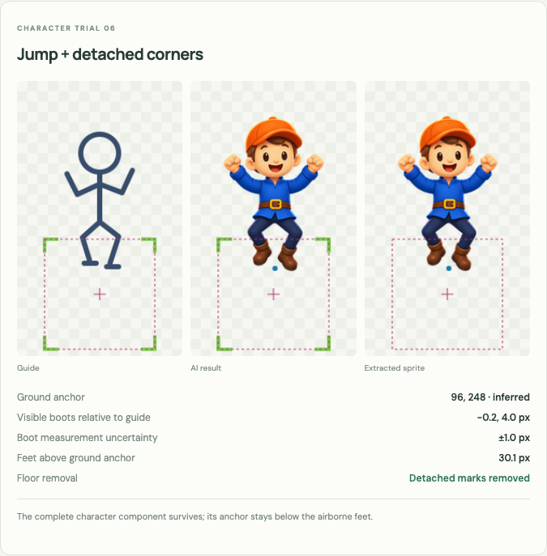
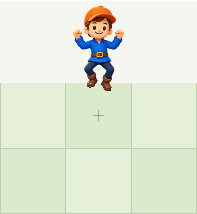
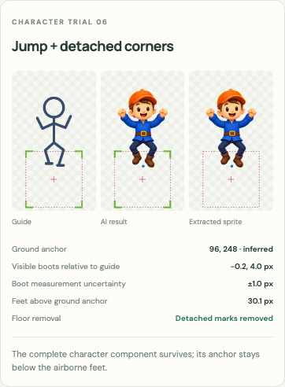

# Character guides, ground anchors, and floor removal

Seven one-shot trials extend the block experiments to an original courier character:
orange cap, cream face, cobalt tunic, brown belt, navy trousers, brown boots.
All calls use built-in imagegen with a transparent background and **one composite
reference image**. The four requested inputs are tested alongside a jumping pair
and a grounded corner-guide control. Each raw output and exact expanded prompt
is retained in `assets/source/` and `assets/prompts/`.

## Geometry contract

The frame remains 192×320 and the logical ground cell remains 128×128. The floor
occupies (32,184)–(160,312). For these character trials, the anchor is the **cell
center (96,248)**, distinct from the existing block/village anchor (96,312).
Character height and jumping elevation do not change the cell pitch.

Standing boot soles should have a midpoint at (96,248). Jumping guides place the
shoe-stroke midpoint near (98,214), 34px above the ground anchor. Floor guides are
screen-aligned squares rather than diamond or perspective tiles. Corner-only
guides replace the filled floor with four detached L marks, leaving its interior
transparent. Their outer stroke bounds are 132×132, centered on the same anchor.

[`character_guides.py`](../tools/character_guides.py) authors the SVGs and 4× rasters.
[`geometry.json`](../assets/character-guides/geometry.json) records this contract.
The raster-character reference is a separate imagegen refinement of the detailed
SVG without a floor, then uniformly normalized to 72px art width and placed above
the known floor. Its [source](../assets/source/character-raster-reference.png) and
[prompt](../assets/prompts/character-raster-reference.json) are retained. It is one
additional preparation call, for eight imagegen calls in total.

## Results

Offsets are approximate visual measurements at the final 128px cell scale;
boot annotations have about ±1px uncertainty. Positive vertical offsets mean
lower on screen. The anchor itself is inferred automatically from the floor,
without using any of these foot annotations.

**Revised interpretation:** the visible shoe bottom is not the ground anchor.
Toe length, thickness, and the viewing angle can extend a standing boot below the
cell center. These offsets describe the silhouette relative to the input guide;
they do not establish anchor error. The floor is the calibration reference for
position and size, independent of foot extent. More detailed guides also constrain
appearance more strongly. A simple stick pose is preferable when the model should
invent the anatomy, clothing, and details. All existing prompts specify the same
courier identity, so these trials do not measure unconstrained design creativity.

| Guide | Visible standing boots relative to center, x / y | Visible jump height, guide 34px | Exact subtraction | Explicit green key |
| --- | --- | --- | --- | --- |
| Floor + height box | −0.2 / +21.4px | — | Failed | Floor removed |
| Floor + stick figure | −0.1 / +2.3px | — | Failed | Floor removed |
| Floor + detailed SVG character | +0.3 / −0.1px | — | Failed | Floor removed |
| Floor + raster character | +0.6 / +0.4px | — | Failed | Floor removed |
| Jumping stick figure + solid floor | — | 50.7px | Failed | Floor removed |
| Jumping stick figure + detached corners | — | 30.1px | Detached component extraction | — |
| Detailed standing SVG + detached corners | 0.0 / +2.9px | — | Detached component extraction | — |

The box trial enlarged and redesigned the character more freely. The stick
guide retained the pose while adding rounded anatomy. The detailed SVG and raster
guides retained more of the supplied proportions and appearance. The solid-floor
jump followed the airborne posture with greater visible elevation than the guide.
Detached-corner jumping was closer to the guide's visible elevation, and both corner
trials produced a complete detachable character.

The detailed standing solid/corner pair uses the same prompt and character SVG;
only the floor representation changes. The two jumping trials likewise use the
same prompt and stick pose, with a filled versus corner-only floor. The other
guide categories use different task instructions, so they are descriptive
comparisons rather than a statistical benchmark of guide complexity.

## Automatic anchors versus independent evaluation

The processing implementation is in [`tilekit.py`](../tools/tilekit.py):

- Solid floor: find the final wide, contiguous opaque-alpha band. Its measured
  median side bounds give the observed floor center, avoiding occasional hand
  protrusions. All five returned floors remained close
  to square (aspect ratios approximately 1.002–1.005). This detector assumes a
  broad screen-aligned calibration tile; it is not a general floor detector.
- Corner floor: require one large character component and four small detached
  components, one in each corner quadrant. Infer the center from their outer
  extents. Unexpected component counts or touching marks are rejected.
- Normalize uniformly using the inferred center and floor span. Preserve the
  complete frame and store anchor (96,248), including when it lies below the feet.

The boot sole coordinates in `assets/character-experiment-config.json` were
visually annotated **only to describe boot placement**. They never set the anchor,
scale, crop, component extraction, or Tiled position. Changing/removing those
annotations does not move the sprite. The production anchor path therefore has
no manual foot fitting, although these initial experiments still received visual
review and a source-specific 64/255 weak-alpha cleanup.

## What floor removal did and did not establish

The initial trial tested **exact-reference subtraction**, not chroma keying. The
follow-up explicitly tests the user's proposed green removal on all five existing
solid-floor images, without generating or selecting new AI outputs.

Every solid floor was repainted with a lighting gradient despite the prompt's
instruction to retain the flat green substrate. Diagnostic subtraction compares
against the known, registered authored floor **pixel for pixel**. It removes only
exact matching RGBA pixels, without guessed background colors or chroma key.
The changed floor remains visible. These five diagnostic images are explicitly
not reusable character sprites.

Flattened opaque floor/character overlaps do not supply an independent character
alpha matte. A floor-shaped cut would remove boots or legs; subtracting the
authored substrate cannot recover mixed antialias pixels after the floor changes.
This experiment does not rule out AI segmentation, a supplied matte, or generative
floor removal, but those were not used to claim exact character preservation.

### Explicit green-key follow-up

The same fixed settings remove the visible floor from all five saved solid-floor
outputs. The key is the authored SVG color `#7bd14b` (RGB 123,209,75), explicitly
supplied rather than inferred from artwork. The method operates only inside the
observed floor bounds, with a 3px allowance for the normalization filter fringe.
It spans ±28° around the supplied hue, with 8° hue feathering and a saturation
transition from .02 to .12. Shaded green floor pixels therefore do not have to
match one exact RGB value. Pure white accents can survive the hue key; only pale,
detached remnants wholly in the known corner regions are removed afterward.

Processing order is **measure floor → uniformly normalize the full composition →
key the floor → retain the frame and anchor**. Neither shoe bounds nor the new
cutout bounds affect scale or position. All five cutouts still have the same
192×320 frame and stored (96,248) anchor. Original PNGs, exact-subtraction
diagnostics, and generation prompts are preserved.

This is a practical cutout, not an exact recovered character matte. Opaque pixels
mixing a boot and floor can lose part of their edge or retain spill. Green clothing
in the floor region would also be keyed, so reserve this hue for calibration or
choose an explicitly different key color. Detached corner accents should be
omitted in future solid-floor guides; a plain green square simplifies removal.
Accessories inside a guide-corner region require review before remnant cleanup.

The updated recommendation for creative generation is **plain green floor +
simple stick pose**, with textual appearance instructions that allow invention.
Use detailed SVG artwork when retaining an existing design is the objective.
Detached corners remain useful when exact preservation of a separated component
is more important than a filled calibration floor.





For the two corner guides, the character and four marks are genuinely detached
alpha components after reviewed weak-alpha cleanup. Flood-fill isolation retains
the character's connected pixels exactly and removes the other components. A
bounding-box crop alone is insufficient: raised hands widen the character's box
so that it can overlap a marker box even when the actual pixels are detached.
Isolation happens before normalization to avoid resampling connecting components.

The corner route depends on the model retaining separate marks and requires
validation. The green-key route depends on a reserved hue and reviewed mixed
edges. Neither route guarantees exact pose or precise jump elevation.

## Rebuild and inspect

Run from the repository root with the Python dependencies installed:

```sh
python tools/build_character_experiments.py
npm run dev
```

Open **Characters**, then enable **Ground anchor**. Each card shows the input,
model result, and cutout. **Solid floor removal** switches between the new green
key and the retained exact-subtraction diagnostic. Pink is the inferred cell
center; blue is the reviewed visible boot midpoint, not an anchor-error indicator.
The final preview places airborne art by its ground anchor on a fixed-pitch grid.

The same processing is available as reusable CLI commands:

```sh
python tools/tilekit.py floor-anchor assets/source/character-jump-corners.png tmp/jump-floor.json --mode corners
python tools/tilekit.py isolate-marked assets/source/character-jump-corners.png tmp/jump-character.png
python tools/tilekit.py subtract-floor public/assets/characters/character-drawn-with-guide.png assets/character-guides/floor-only.png tmp/floor-subtraction-diagnostic.png
python tools/tilekit.py key-floor public/assets/characters/character-stick-with-guide.png tmp/stick-keyed.png --key-rgb 123 209 75 --remove-corner-remnants
```

Processed sprites and machine results are in `public/assets/characters/`,
[`characters.json`](../public/assets/characters.json), and
[`character-comparison.json`](character-comparison.json). Clean outputs include:

- [Jumping courier](../public/assets/characters/character-jump-corners-removal.png)
- [Standing courier](../public/assets/characters/character-standing-corners-removal.png)
- [Green-key standing stick courier](../public/assets/characters/character-stick-keyed.png)
- [Green-key jumping courier](../public/assets/characters/character-jump-solid-keyed.png)

`characters-tiles.json` contains all seven cutouts, records approximate chroma
versus detached-alpha extraction, and retains full 192×320 frames and their local
(96,248) anchors. `characters-scene.json` demonstrates the solid-floor jump and
sets `groundAnchorAlignment: "center"`; the
default for previous scenes remains `"bottom"`. Browser and Tiled placement use
the cell center. The Tiled tileset offset is (0,72), compensating for the image's
72px below its stored anchor. [`characters.tmj`](../public/assets/characters.tmj)
is exported with these coordinates; a native Tiled editor was not used for QA.

Unit tests cover floor-center inference independent of feet/color, detached
pixel preservation despite overlapping component boxes, refusal of touching
guides, retention of repainted floor pixels, explicit chroma removal with shoe
and outside-region preservation, soft matte behavior, pale detached accents,
and Tiled placement of a floating ground anchor. The suite now has 42 passing
unit tests, including skill-eval and safe panel-recovery regressions. Browser
verification covers both removal modes, actual keyed/diagnostic canvas pixels,
all seven cards, the jump preview, and 390/320px layouts. These are browser captures:









One output per condition cannot estimate reliability. Model version and seed are
not recorded by the built-in tool. Broader animations, detached accessories,
multiple simultaneous characters, perspective floors, and occluded/touching
corner marks need additional detection and acceptance rules.
