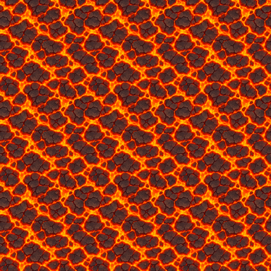
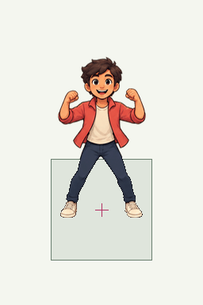
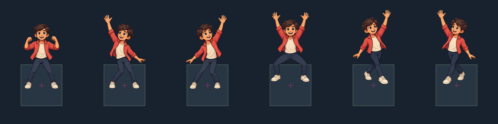
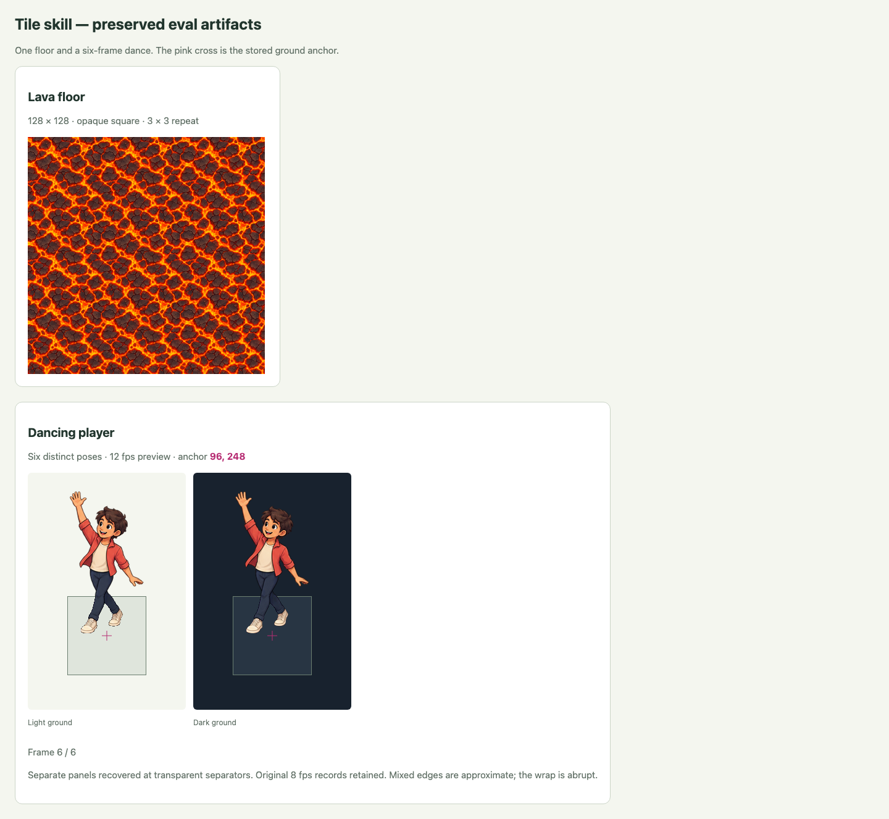
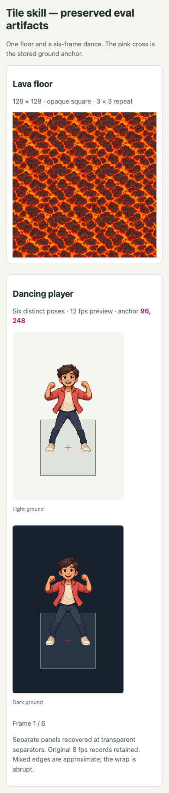

# Repo skill and fresh behavioral evals

This is the historical v1 pilot report. Its two-case rubric and original 8 fps
records are preserved in `assets/evals/2026-10-11-skill-v1/`. The portable
[13-case v2 suite](portable-skill-evals.md) is specified but has not been run.
The gallery derives 12 fps playback from these old frames; that is not a new
generation or an animation-quality result for v2.

The updated [build-overlap-tiles skill](../skills/build-overlap-tiles/SKILL.md)
covers visible floor generation and object/animation generation on a removable
calibration floor. Its [workflow reference](../skills/build-overlap-tiles/references/floor-and-objects.md)
contains runnable guide, generation, normalization, keying, and spritesheet steps.

Two independent executor agents received only a short user request, the skill,
and an isolated output directory. They generated fresh artwork rather than
reusing the courier experiments. Root separately graded the artifacts and
inspected their source/guide/output images. Three image-generation calls were
made: one lava tile, a first dance sheet, and one corrected dance retry.

| Trial | Artifact checks | Visual outcome | Recorded status |
| --- | --- | --- | --- |
| `generate a lava tile` | Full opaque 128×128; center (64,64); complete material uniformly resampled | Lava readable; repeated image inspected; some channel mismatch at joins | Passed |
| `generate a player dancing spritesheet on tile`, first attempt | Six frames, center (96,248), floor-derived normalization and usable keying | Final two poses repeat the same arm direction/stance | Failed |
| Same dance request, corrected retry | Strict layout initially refused; transparent-separator recovery preserves fingers and passes all geometry checks | Six distinct poses, opposite final arm/crossed-step pair, consistent player, usable light/dark cutouts | Passed after explicit recovery |

The outputs are pilots. Lava pattern continuity is approximate. The dance has an
abrupt wrap and modest pose-dependent apparent size/elevation variation; it is
not a production-smooth loop. Chroma matting at mixed edges remains approximate.
One outcome per prompt/attempt does not estimate reliability.

## What the eval changed

The first dance call followed generic pose guidance but duplicated the final
pair. The skill now spells out all six row-major actions, particularly the
opposite final arms and crossed steps. It preserves failed generations and caps
the ordinary batch retry at one.

The corrected image has fully opaque fingertips extending into the planned
horizontal gutter. Strict processing refused to slice them. The safe recovery
searches for completely transparent separator rows/columns inside each guide
gutter, partitions the entire cleaned source there, and records the actual source
rectangles. Every cleaned source-alpha pixel belongs to one panel before
normalization/keying. No fingertip is cut and no foot annotation moves an anchor.
Touching panels without a transparent separator still fail, as does frame overflow.
The original strict failure and its diagnostic are preserved in the retry folder.

A separate real hand protrusion into the top edge of a calibration floor exposed
an overly sensitive width measurement. Median side edges over the broad floor
band prevent a few hand pixels from enlarging the measured tile. The first
attempt's original processing outputs remain in `processed-original/`; current
outputs replay the robust measurement from the same untouched source.

The grader also avoids treating an opaque brown hand at a floor corner as a
remaining floor. Automatic removal checks target the explicitly reserved hue;
independent light/dark review assesses pale spill and damaged edges. A matching
opaque key-color pixel fails, while a preserved non-green hand does not.

## Reproduce or run fresh

```sh
# Replay retained sources and reviews; the failed first dance must remain failed
npm run eval:skill

# Includes live anchored playback of the real eval frames, desktop and mobile
npm run verify
```

[Case definitions](../skills/build-overlap-tiles/evals/cases.json) specify geometry,
timing, and visual criteria. [The eval protocol](../skills/build-overlap-tiles/evals/protocol.md)
explains fresh independent runs, submission/recipe schemas, grading, and review.
Saved replay does not rerun an agent or image generation and cannot establish
that a changed skill will elicit the same behavior. Use a new run ID and fresh
calls to measure that. A missing visual review is pending, never an automatic pass.

The [run record](../assets/evals/2026-10-11-skill-v1/run.json) describes iteration
and hashes the final skill snapshot. Recipes preserve the actual prompts used
before/after correction; the final snapshot does not imply both attempts used
identical instructions. The [summary](evals/2026-10-11-skill-v1/summary.json)
records the expected failed example separately from the passing final cases.

Sources, exact recipes, SVGs/rasters, layout JSON, normalized outputs, and reviews:

- [Lava source](../assets/evals/2026-10-11-skill-v1/lava-tile/source.png),
  [recipe](../assets/evals/2026-10-11-skill-v1/lava-tile/generation.json),
  [artifact/visual report](evals/2026-10-11-skill-v1/lava-tile.json).
- [Failed first dance source](../assets/evals/2026-10-11-skill-v1/dancing-player/source.png),
  [recipe](../assets/evals/2026-10-11-skill-v1/dancing-player/generation.json),
  [failed report](evals/2026-10-11-skill-v1/dancing-player.json).
- [Corrected dance source](../assets/evals/2026-10-11-skill-v1/dancing-player-retry/source.png),
  [recipe](../assets/evals/2026-10-11-skill-v1/dancing-player-retry/generation.json),
  [strict failure](../assets/evals/2026-10-11-skill-v1/dancing-player-retry/processing-failure.json),
  [recovered frames/anchors](../assets/evals/2026-10-11-skill-v1/dancing-player-retry/processed-recovered/result.json),
  [passing report](evals/2026-10-11-skill-v1/dancing-player-retry.json).

## Actual previews











All 42 Python tests, skill validation, saved-eval replay, `npm run assets`,
production build, and browser verification pass. Regressions include invalid
source/provenance, missing review, wrong anchors, non-square/transparent material,
strict gutter refusal, complete finger recovery, and refusal of touching panels.
