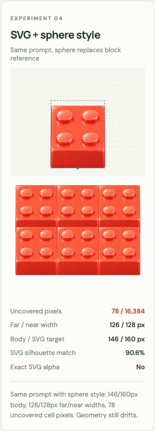
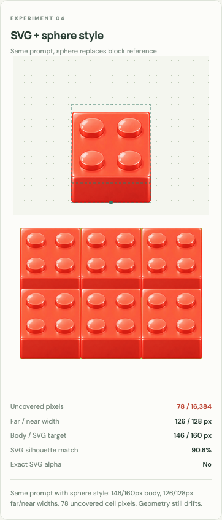

# Sphere style reference follow-up — 2026-10-11

Question: does replacing a rendered block style reference with a smooth plastic
sphere reduce distortion when AI renders the same SVG geometry?

## Preserved inputs and actual calls

- Original scene: [`5610.jpg`](../assets/references/5610.jpg), a byte-for-byte copy
  of the user attachment. [`5610.json`](../assets/references/5610.json) records its
  SHA-256 and provenance. The scene contains red and orange studded blocks,
  cottages, crates, trees, roads, and characters. It is a style reference, never
  a source for slicing overlapping objects.
- Sphere generation: built-in imagegen, transparent background, one input image
  (`5610.jpg`). The [exact prompt](../assets/prompts/plastic-style-sphere.json)
  requests a single smooth coral-red glossy toy-plastic ball, with no studs or
  block faces. The untouched [sphere PNG](../assets/source/plastic-style-sphere.png)
  carries surface shading and highlights without block proportions.
- Block generation: built-in imagegen, transparent background, two ordered inputs:
  [`reference-4x.png`](../assets/templates/block-32/reference-4x.png), then the sphere.
  The [exact prompt](../assets/prompts/svg-sphere-block.json) is identical to the
  [earlier block-style trial](../assets/prompts/svg-guided-block.json). Its existing
  instruction says Image 1 owns geometry and Image 2 supplies material/illustration
  style only. Only the second reference image changes. The build checks this
  invariant before processing. Untouched output:
  [`svg-sphere-block.png`](../assets/source/svg-sphere-block.png).

The SVG reference is a 768×1280 raster of a 192×320 frame: 128×128 top face,
32px front wall, four identical studs, and ground anchor (96,312). The sphere
and new block were each generated once. No rejected or selected alternative
outputs were used.

## Processing and measurements

Raw block size: 971×1619. Visual inspection and alpha measurements show weak edge
haze. The same alpha floor (64/255) and full-art width (130px) as the historical
SVG trials are used. At alpha ≥64, the full silhouette is (150,759)–(822,1522);
the reviewed ground contact is (486,1522). The pipeline crops transparent margins,
scales uniformly, and places this contact at (96,312) in a 192×320 frame. No
silhouette clipping, face replacement, perspective correction, or independent-axis
stretching is used. Integer resampling dimensions and any subpixel anchor shift
are recorded in the comparison JSON.

Rebuild from the repository root:

```sh
python tools/build_experiments.py
npm run dev
```

Open **Workflows** to see all five trials and toggle the SVG outline. Machine
measurements are saved in [`workflow-comparison.json`](workflow-comparison.json).
Opaque geometry uses alpha ≥250; repeated coverage uses a 128px grid pitch.

| Whole-object trial | Body / 160px target | Far / near span | Missing cell pixels | Silhouette IoU |
| --- | --- | --- | --- | --- |
| SVG + rendered block style | 131px | 128 / 128px | 0 | 81.8% |
| SVG only, historical prompt | 160px | 128 / 128px | 0 | 98.8% |
| SVG + sphere style, unchanged two-image prompt | 146px | 126 / 128px | 78 | 90.6% |

The sphere trial still distorts geometry: the body is 14px (8.75%) short and the
near span is 2px wider than the far span. Coverage misses 78 of 16,384 central-cell
pixels (0.48%). Its silhouette overlap improves over the block-style trial, but
is below the historical SVG-only trial. Exact SVG alpha remains false.

Visual inspection also shows that the new block transfers the sphere's glossy
highlights while adding its own bevels and stud shading. These opacity/silhouette
metrics do not establish exact stud shapes, positions, or top/front boundaries.

## What this trial establishes

Using a sphere removes the explicit competing block silhouette from the style
input, but did not eliminate geometry drift in this output. Improvement could
reflect the different style image, stochastic generation, or model changes between
the historical and current calls. Neither model version nor seed is recorded by
the built-in tool. The historical SVG-only prompt also differs, so that comparison
is descriptive rather than a controlled style/no-style pair. Multiple fresh calls
per condition would be needed to estimate reliability or isolate causality.

The earlier four-card screenshot is retained as
[`preview-workflows-original.png`](preview-workflows-original.png). The updated
comparison and sphere SVG overlay are actual browser screenshots:





